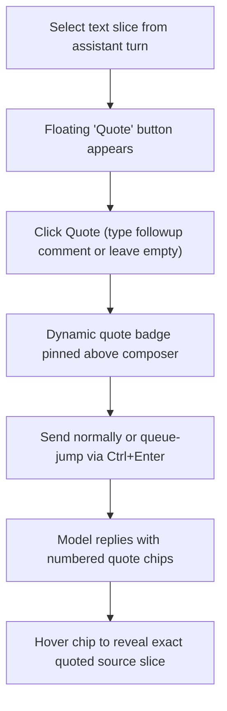

[简体中文](README.md) | English

# dsh-annotation-patched

**An enhanced select-and-quote interaction plugin for the DeepSeek Harness (DSH) Web client.**

A locally enhanced, production-grade fork of the official DSH Web text annotation and quoting plugin (maintained under the independent package name `@dsh-external/dsh-annotation-patched` to prevent upstream collision). It eliminates upstream quirks including ghost quote leakage, composer coordinate glitches, chain-of-thought pollution, and dropped quotes on queue-jumped messages.

---

## Core Enhancements & Solved Issues

* **Single-Click Pure Quote (Empty Note Mode)**: Select text in an assistant bubble and click "引用" (Quote) to send an immediate reference without typing extra prompt text, matching OpenAI Codex's natural "Add to chat" interaction pattern.
* **Complete Ghost-Quote Elimination**: Ties quote buffer clearing strictly to confirmed send states and draft emptiness, supported by regex stripping that prevents leftover quotes from attaching to subsequent unrelated messages.
* **Adaptive Multi-Line Composer Anchoring**: Utilizes `ResizeObserver` to track dynamic height changes in the Lexical input box, keeping the `引用 ×N` badge fixed neatly above the composer without overlapping typed text.
* **Thinking Block Sanitization**: For legacy model providers that stream chain-of-thought inline as `<think>` tags, it strips reasoning text before parsing annotations—preventing numbered internal thoughts from creating spurious quote chips.
* **Slash Skill Integration**: Quoted blocks travel safely when invoking custom skills (such as `/human-writing`), properly appending context without breaking command parameter evaluation.
* **Ctrl+Enter Queue-Jumping Support**: Pressing `Ctrl+Enter` to inject high-priority messages while a conversation turn is active preserves and binds all active quotes reliably.
* **Maintainable Patch Replay Architecture**: Every local enhancement carries anchored `PATCH` markers; automated replay via `scripts/apply-patches.mjs` allows instant rebasing onto new upstream commits.

---

## Interactive Workflow



---

## Installation & Setup

### Install via DSH Plugin Manager (Recommended)

```bash
dsh plugin --profile web add github:DDDFXYqiming/dsh-annotation-patched
```

### Local Development

```bash
git clone https://github.com/DDDFXYqiming/dsh-annotation-patched.git
cd dsh-annotation-patched
npm install && npm run build
dsh plugin --profile web add .
```

*Note: Since this operates in the browser client, perform a hard reload (`Ctrl+F5`) in DSH Web after installing or updating.*

---

## Upstream Patch Replay

To rebase local patches onto a newer upstream commit:

```bash
node scripts/apply-patches.mjs --fetch <upstream-commit> --out client.js
npm test
```

The script automatically applies localized terminology swaps, validates all 81 anchored mutations, and executes compatibility tests.

---

## License

This project is open-sourced under the [MIT License](LICENSE) (preserving upstream copyrights).
