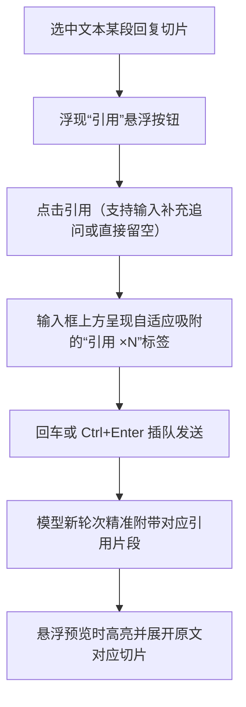

简体中文 | [English](README.en.md)

# dsh-annotation-patched

**DeepSeek Harness (DSH) Web 划词引用与精准交互强化扩展**（fork 维护，v0.3.7）。

本仓库是 DSH 官方 Web 划词引用插件的深度强化 Fork 版本（独立包名 `@dsh-external/dsh-annotation-patched`，避免与上游包名冲突）。针对原生插件在长对话与复杂操作中频发的幽灵引用残留、多行输入框错位、思维链标签污染及插队消息失效等痛点，进行了彻底的工程级重构与交互增强。

---

## 解决的核心痛点与功能特性

* **单键纯引用模式（Empty Quote Support）**：在助手回复中选中文字后点击“引用”，无需强制输入补充问题即可直接发送纯引用，操作体验完美对齐 Codex 交互逻辑。
* **根治幽灵引用残留（Ghost-Quote Fix）**：将引用清理时机绑定至精确的“发送成功”与草稿状态流，并引入正则剥离机制，杜绝上一轮未清理引用错误附着到后续普通消息的问题。
* **多行输入框自适应吸附**：基于 `ResizeObserver` 动态追踪输入框高度与尺寸变化，“引用 ×N”标签始终精准停留在输入框顶部，不再因长文输入而被遮挡或侵入内容区。
* **思维链标签智能剥离（Think Tag Stripping）**：针对将思维链作为纯文本流式输出的模型服务，自动清洗回复中的 `<think>` / `<thought>` 块，防止模型自言自语中的编号与引文碎片误触发悬浮气泡。
* **斜杠技能（Slash Skill）无缝联动**：在使用 `/name` 格式呼叫自定义 Skill（如 `/human-writing`）时，选中的引用块自动随消息安全附带递送，不破坏技能指令解析。
* **Ctrl+Enter 插队消息支持**：在模型正在流式输出时通过 `Ctrl+Enter` 抢占式发送消息，引用块同样完整组装并随插队指令递送，消息气泡自动规整展示。
* **可维护的补丁重放架构**：每个修改点均带 `PATCH` 锚点注释，并配备 `scripts/apply-patches.mjs` 与自动化补丁重放清单，上游升级时可一键无损迁移。

---

## 交互流程示意



---

## 安装与快速上手

### 通过 DSH 插件系统安装（推荐）

```bash
dsh plugin --profile web add github:DDDFXYqiming/dsh-annotation-patched
```

### 本地开发与引入

```bash
git clone https://github.com/DDDFXYqiming/dsh-annotation-patched.git
cd dsh-annotation-patched
npm install && npm run build
dsh plugin --profile web add .
```

*注意：本插件作用于浏览器前端，安装或更新后建议在 DSH Web 界面按 `Ctrl+F5` 进行强制刷新以确保加载最新静态资源。*

---

## 补丁维护机制

若上游发布了新的基础版本，可通过内置的重放脚本执行平滑迁移：

```bash
# 获取上游 commit 并自动重放本地全部增强补丁
node scripts/apply-patches.mjs --fetch <upstream-commit> --out client.js
npm test
```

重放工具将自动完成术语一致性校验、81 条锚定 op 精确打补丁以及前端兼容性测试。

---

## 许可证

本项目基于 [MIT License](LICENSE) 开源（保留上游版权信息）。
